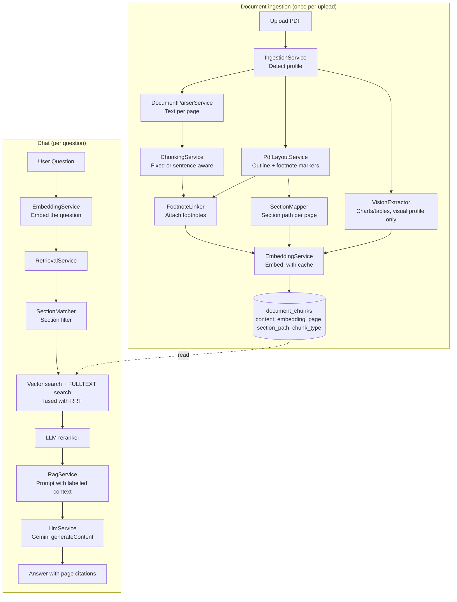

# Advanced RAG Chatbot

A **RAG (Retrieval-Augmented Generation)** chatbot that answers questions
about PDFs, grounded only in the document's content, with page and section
citations.

It started as a basic RAG chatbot (Phase 1:
[document-rag-chatbot](../document-rag-chatbot)) and was extended for the
**Advanced RAG hands-on challenge**: three documents with deliberately
different shapes, each needing a different pipeline design.

| Document | Shape | What the pipeline does differently |
|---|---|---|
| GPO 2018 Annual Report (82 pages) | Narrative text with facts in sentences | Sentence-aware chunking |
| World Bank Global Economic Prospects, June 2026 (200 pages) | Long, chapters / regions / boxes | Section paths from the PDF outline, section-filtered + hybrid retrieval, reranking |
| Apple iMac Product Environmental Report (12 pages) | Facts in charts, tables, call-outs, footnotes | Vision extraction of every page, footnotes linked to the claims they qualify |

Results, design decisions and before/after numbers are in
[docs/ADVANCED-RAG-REPORT.md](docs/ADVANCED-RAG-REPORT.md).

Built with Laravel 11, Vue 3, Inertia.js, MySQL and the Google Gemini API
(free tier).

## What this project does

1. You upload a PDF.
2. The app works out what kind of document it is (its **profile**:
   narrative, structured or visual) and processes it accordingly: extracts
   text page by page, reads the bookmark outline and footnote markers, and
   for short visual documents has Gemini read each page image for charts
   and tables. It then splits everything into chunks tagged with page,
   section and type, embeds them, and stores them in MySQL.
3. You ask a question in the chat UI.
4. The app retrieves the most relevant chunks (section filter, vector +
   keyword search, LLM reranking) and sends them to Gemini with your question.
5. The LLM answers **using only the document's content**, citing the pages
   it used. If the answer isn't in the document, it says so instead of guessing.

## What is RAG?

A plain LLM only knows what it was trained on — it has never seen your PDF.
RAG (Retrieval-Augmented Generation) works around that by fetching relevant
pieces of *your* document at question time and handing them to the LLM as
context, so it can answer as if it had read the document.

| Term | Meaning |
|---|---|
| **Chunk** | A small piece of the original document's text (e.g. a few paragraphs). Documents are split into chunks because LLMs and embedding models work on limited amounts of text at once. |
| **Embedding** | A list of floating point numbers that represents the *meaning* of a piece of text. Two pieces of text with similar meaning get embeddings that are numerically close together. |
| **Vector search** | Comparing the question's embedding against every chunk's embedding to find the ones with the closest/most similar meaning. |
| **Keyword (FULLTEXT) search** | Finding chunks that contain the question's exact words — good at names, codes and numbers that embeddings blur. |
| **Hybrid search** | Running both searches and merging their rankings (here with Reciprocal Rank Fusion). |
| **Reranking** | A second, more careful pass (here: the LLM) that reorders the candidates by how well they answer the question. |
| **Retrieval** | The act of finding and fetching those relevant chunks. |
| **Augmentation** | Inserting the retrieved chunks into the prompt sent to the LLM, as "context". |
| **Generation** | The LLM reading the question + context and producing the final answer. |

## Architecture



### Document profiles

`IngestionService` picks a profile from the PDF's length and outline
(thresholds in `config/rag.php`):

| Profile | Detected when | Chunking | Extra processing |
|---|---|---|---|
| `structured` | ≥ 100 pages and a bookmark outline | Fixed-size (structure is handled at retrieval) | Section path on every chunk |
| `visual` | ≤ 20 pages | Sentence-aware | Footnote linking; Gemini vision on every page, producing `visual` chunks |
| `narrative` | anything else | Sentence-aware | Footnote linking |

Section paths are added for any profile when the PDF has bookmarks.

### Retrieval stages

`RetrievalService` runs these stages; each can be switched off in
`config/rag.php` (or per evaluation run) to measure its effect:

1. **Section filter** (`RAG_SECTION_FILTER`): if the question names a
   section ("Chapter 3", "South Asia", "executive summary"), only that
   section's chunks are searched.
2. **Hybrid search** (`RAG_HYBRID`): vector search and MySQL FULLTEXT search
   (over chunk text and section titles), merged with Reciprocal Rank Fusion.
3. **Reranking** (`RAG_RERANK`): Gemini picks the most useful of the top 15
   candidates; the remaining context slots are filled in search order.

The context passed to the LLM labels every chunk with its page and section,
e.g. `[Source: p. 96 | Ch. 2 Regional Outlooks > South Asia]`, and the
prompt tells it not to move figures between sections and to keep footnote
conditions.

### Laravel structure

```
Controller -> FormRequest -> Service -> Model / External API
```

- `app/Http/Controllers/DocumentController.php` — upload & list documents.
- `app/Http/Controllers/ChatController.php` — show chat, handle questions.
- `app/Jobs/ProcessDocumentJob.php` — runs ingestion in the background.
- `app/Services/IngestionService.php` — picks the profile and runs the ingestion steps.
- `app/Services/DocumentParserService.php` — PDF -> text per page.
- `app/Services/PdfLayoutService.php` — bookmarks, footnote markers, page images (poppler).
- `app/Services/ChunkingService.php` — text -> fixed-size or sentence-aware chunks with pages.
- `app/Services/SectionMapper.php` — bookmarks -> section path per page.
- `app/Services/FootnoteLinker.php` — footnote texts -> the chunks that cite them.
- `app/Services/VisionExtractor.php` — page images -> descriptions of charts and tables.
- `app/Services/EmbeddingService.php` — text -> embedding (Gemini), cached, rate-limit aware.
- `app/Services/RetrievalService.php` — section filter, hybrid search, reranking.
- `app/Services/SectionMatcher.php` — finds the sections a question names.
- `app/Services/VectorSearchService.php` — cosine similarity search.
- `app/Services/LlmService.php` — prompt (+ images) -> answer (Gemini), with fallback model.
- `app/Services/RagService.php` — orchestrates the chat flow.
- `app/Console/Commands/RagIngestCommand.php` — `php artisan rag:ingest`.
- `app/Console/Commands/RagEvalCommand.php` — `php artisan rag:eval`.
- `app/Console/Commands/RagEvalCompareCommand.php` — `php artisan rag:eval-compare`.

### Database

| Table | Purpose |
|---|---|
| `documents` | One row per uploaded PDF: name, storage path, status, `profile`, `page_count`. |
| `document_chunks` | One row per chunk: `content`, `embedding` (JSON), `page_start`/`page_end`, `section_path`, `chunk_type` (`text`/`visual`). FULLTEXT index on `content` + `section_path`. |
| `embedding_cache` | Every embedding ever computed, keyed by a hash of model + text, so the same text is never sent to the API twice. |
| `conversations` | One conversation per document. |
| `messages` | `role` (`user`/`assistant`) + `content`, belongs to a conversation. |

### Vector search implementation

Embeddings are stored as a JSON column in MySQL — no separate vector
database. At query time, `VectorSearchService` computes
[cosine similarity](https://en.wikipedia.org/wiki/Cosine_similarity) in PHP
against every chunk of the document (optionally only those in the matched
sections). This brute-force approach is simple and fast enough for a few
documents of a few hundred pages; at larger scale only `VectorSearchService`
would need to change (e.g. to pgvector).

## Technologies used

- **Laravel 11** (PHP 8.2) — backend framework.
- **Vue 3** (Composition API, `<script setup>`) + **Inertia.js** — frontend, no separate API/SPA needed.
- **MySQL** — documents, chunks (+ embeddings as JSON, FULLTEXT index), conversations, messages.
- **Laravel Queue** (`database` driver) — processes uploaded PDFs in the background.
- **Google Gemini API** (free tier) — `gemini-embedding-001` for embeddings; `gemini-flash-latest` (falling back to `gemini-flash-lite-latest`) for answers, reranking, vision and evaluation judging.
- **smalot/pdfparser** — PDF text extraction.
- **poppler-utils** (`pdfinfo`, `pdftohtml`, `pdftoppm`) — PDF outline, layout and page rendering.
- **Tailwind CSS** — minimal styling.

## Installation

```bash
composer install
npm install          # needs Node 18+ (Vite 6)

cp .env.example .env
php artisan key:generate
```

The ingestion pipeline also needs **poppler-utils** (`pdfinfo`, `pdftohtml`,
`pdftoppm`), e.g. `sudo apt install poppler-utils`.

## Environment variables

`cp .env.example .env` already sets sensible defaults for everything except
your database credentials and API key. What you actually need to fill in or
change:

| Variable | Required? | What it's for |
|---|---|---|
| `DB_DATABASE`, `DB_USERNAME`, `DB_PASSWORD` | **Yes** | Point these at a MySQL database/user that exists on your machine (see "Database setup" below). `DB_HOST`/`DB_PORT` default to `127.0.0.1`/`3306`. |
| `GEMINI_API_KEY` | **Yes** | Used for embeddings, answers, reranking, vision and evaluation. Works on the free tier (see "Free-tier limits" below). Get one free at <https://aistudio.google.com/app/api-keys>. It's read only from the environment (`config/services.php`) — never hardcoded or sent to the frontend. Must be a Gemini key, not an OpenAI key (they're not interchangeable — see "Provider" note below). |
| `GEMINI_EMBEDDING_MODEL` | No (has a default) | Defaults to `gemini-embedding-001`. Only change if Google renames/deprecates it. |
| `GEMINI_CHAT_MODEL` | No (has a default) | Defaults to `gemini-flash-latest`, a stable alias that always points at Google's current fast/cheap model — safer than pinning a dated model name, which Google periodically deprecates. |
| `GEMINI_CHAT_FALLBACK_MODEL` | No (has a default) | Defaults to `gemini-flash-lite-latest`. Used only when the main chat model is overloaded (503/429/5xx) even after retries, so a busy model doesn't turn into a failed answer. |
| `RAG_HYBRID`, `RAG_SECTION_FILTER`, `RAG_RERANK` | No (default `true`) | Switch the retrieval stages on/off (see "Retrieval stages"). `RAG_TOP_N` (default 5) sets how many chunks go to the LLM. |
| `QUEUE_CONNECTION` | No (has a default) | `database` by default (background processing via `php artisan queue:work`, see "Running the application"). Set to `sync` if you don't want to run a worker. |
| `DB_QUEUE_RETRY_AFTER` | No (set in `.env.example`) | `1900`. Must be longer than the processing job's 30-minute timeout, otherwise a long PDF (e.g. the 200-page report) is picked up a second time while still running and then marked failed. |
| `APP_KEY` | **Yes**, but auto-generated | Set by `php artisan key:generate` during install; don't set it by hand. |

Everything else in `.env.example` (session, cache, mail, etc.) is standard
Laravel scaffolding you can leave as-is for local development.

> **Provider note:** this app calls Google's Gemini API, not OpenAI. A key
> from <https://platform.openai.com> (format `sk-...`) will not work here —
> you specifically need a Gemini key from Google AI Studio (format
> `AQ...`/similar). Pasting the wrong kind of key produces a `401 Incorrect
> API key` error when a document is processed.

## Database setup

Create the database, then run migrations:

```bash
mysql -u root -e "CREATE DATABASE advanced_rag_chatbot"
php artisan migrate
```

## Vector storage setup

Nothing extra to install — embeddings live in the `document_chunks.embedding`
JSON column of your existing MySQL database (see "Vector search
implementation" above).

## Free-tier limits

The Gemini free tier allows **1,000 embedding requests per day**, 100 per
minute (each chunk counts as one) and **30,000 embedded tokens per minute**.
The app is built around that:

- Every embedding is stored in `embedding_cache`, so re-processing a
  document or re-asking a question never spends quota twice.
- Embeddings are sent in batches of at most 100 texts and about 24,000
  estimated tokens, and the app pauses before a minute's total would pass
  the token limit (a 100-chunk batch of the World Bank report's dense
  tables is already ~30,000 tokens, which the API rejects every time). On
  a per-minute 429 it waits as long as the API asks and retries; on the
  daily limit it stops at once with a clear message.
  Batches already embedded are kept, so the next attempt resumes.
- The 200-page World Bank report alone needs 911 embeddings, so load it on a
  day when nothing else has been embedded.

Chat calls (answers, reranking, vision, evaluation judging) have their own,
separate limits; on a per-minute limit the app waits for the time the API
asks for.

## Command-line tools

```bash
# Ingest PDFs (same pipeline as uploading them; --replace removes older copies)
php artisan rag:ingest --replace ~/Downloads/GPO-Anual-report.pdf

# Evaluate against resources/eval/questions.json (17 questions with known answers)
php artisan rag:eval                         # all stages on
php artisan rag:eval --baseline              # plain vector search only
php artisan rag:eval --no-rerank --doc=GEP-Jun-2026 --show-answers

# Compare saved runs side by side (Markdown tables for the report)
php artisan rag:eval-compare baseline full
```

`rag:eval` prints, for every question, the sections it was matched to, the
pages retrieved, whether one of them is the page the answer is on, and an
LLM judge's pass/fail against the expected answer. Each run is saved to
`storage/app/eval/` with its settings.

## Running the application

You need three things running:

```bash
php artisan serve       # backend + Inertia pages
npm run dev              # Vite dev server (Vue/JS)
php artisan queue:work   # processes uploaded PDFs in the background
```

Then open the app (default `http://127.0.0.1:8000`).

> If you don't want to run a queue worker, set `QUEUE_CONNECTION=sync` in
> `.env` — documents will then be processed synchronously during the upload
> request instead of in the background. This is fine for small PDFs and
> simplest to run locally; switch back to `database` (plus `queue:work`,
> or Redis via `QUEUE_CONNECTION=redis`) once processing time becomes
> noticeable.

> **Restart the worker after changing PHP code.** `php artisan queue:work`
> is a long-running process — it loads your service classes into memory
> once and keeps running, so editing e.g. `EmbeddingService.php` while a
> worker is already running has no effect until you stop (Ctrl+C) and
> restart it, or run `php artisan queue:restart`. Forgetting this looks
> like the code change "didn't work" when it actually just isn't loaded yet.

## How document processing works

1. `DocumentController::store()` validates the upload (PDF only, ≤10MB),
   stores the file under `storage/app/private/documents` with a generated
   filename (the original filename is never trusted), creates a `documents`
   row with `status: pending`, and dispatches `ProcessDocumentJob`.
2. The job sets `status: processing`, then runs:
   - `IngestionService::prepare()` — detects the profile, extracts text per
     page, chunks it (fixed-size or sentence-aware), links footnotes, adds
     vision chunks for visual documents, and tags chunks with page and
     section (see "Document profiles").
   - `EmbeddingService::embedBatch()` — embeds the chunks in batches of 100,
     reusing cached embeddings.
   - Saves each chunk + its embedding and metadata to `document_chunks`.
3. On success, `status` becomes `completed`; on any failure, `status`
   becomes `failed` with a user-friendly `error_message` (the technical
   error is logged, not shown to the user).
4. The Documents page polls the server every few seconds while anything is
   pending/processing, so the status updates automatically. For each
   document it shows the page count and the number of chunks stored (for
   visual documents, how many of them came from charts/tables).

## Removing a document

Click "Remove" next to a document on the Documents page. This deletes the
stored PDF file, the `documents` row, and everything derived from it
(`document_chunks`, `conversations`, `messages`) via cascading foreign keys —
see `DocumentController::destroy()`.

## How chat works

1. `ChatController::show()` renders the chat page for a document, loading
   its (single) conversation and messages so far.
2. `ChatController::store()` validates the question, refuses it if the
   document isn't `completed` yet, saves the question as a `user` message,
   and calls `RagService::ask()`.
3. `RagService::ask()` runs the RAG pipeline: embed the question, retrieve
   chunks with `RetrievalService` (section filter, hybrid search, reranking),
   build a prompt that labels each chunk with its page and section and
   instructs the LLM to answer only from that context and cite pages, and
   call `LlmService::generate()`.
4. The answer is saved as an `assistant` message and the page reloads with
   the updated conversation.

The chat page (`resources/js/Pages/Chat/Show.vue`) fills the browser
viewport: only the message list scrolls (auto-scrolling to the latest
message), while the header and question input stay fixed in place.

If a session/CSRF token expires (e.g. a tab left open a long time), the app
reloads the current page automatically instead of showing Laravel's raw
"419 | Page Expired" screen — see the `router.on('invalid', ...)` handler in
`resources/js/app.js`.

## Example question/answer

Given a PDF containing:

> Employees are allowed 12 casual leaves per year.

Asking **"How many casual leaves are allowed?"** returns:

> According to the document, employees are allowed 12 casual leaves per year. (Source: p. 3)

Asking something the PDF never mentions, e.g. **"What is the CEO's salary?"**,
returns something like:

> The information was not found in the uploaded document.

## Limitations

- Brute-force vector search in PHP — fine for a handful of documents, not
  built for scale (see "Vector search implementation").
- One conversation per document, no multi-document chat.
- Profile detection is a simple length/outline rule; an unusual document
  may get a less suitable profile.
- Section paths depend on the PDF having bookmarks; a long report without
  them gets no section-aware retrieval.
- Structured reports keep fixed-size chunks (see the report for why), so a
  chunk can still straddle two sections; it is labelled with the section
  it starts in.
- Footnote markers are detected from font size and position, which suits
  typical superscript markers but not every layout.
- Vision extraction runs on every page of short documents only; charts in
  long reports are read as plain text.
- No authentication — anyone with access to the app can see all documents.
- No PDF OCR — scanned/image-only PDFs with no text layer won't extract
  any content.
- No streaming responses; the answer appears once fully generated.

## Possible future improvements

- Swap `VectorSearchService`'s implementation for a real vector database
  (pgvector, Pinecone, etc.) if the number of chunks grows large.
- Section-bounded chunks with the section path embedded in the chunk text
  for structured reports (costs a full re-embedding on the free tier).
- Vision extraction for only the pages of long reports that contain charts.
- A dedicated reranking model (cross-encoder) instead of the LLM.
- Multi-document chat / cross-document search.
- Streaming answers token-by-token.
- User accounts so each user only sees their own documents.
